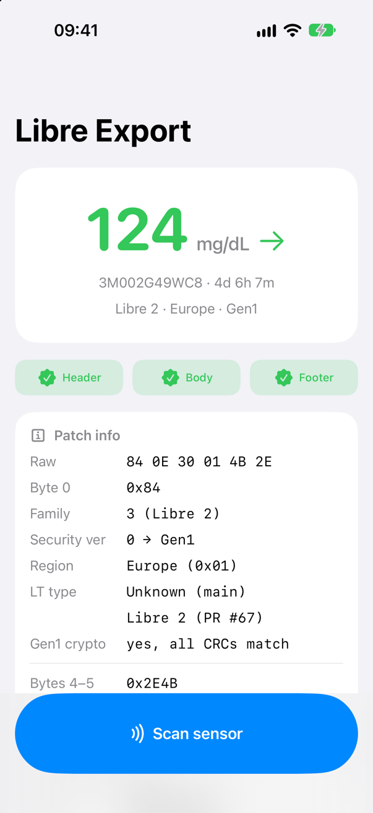

# Libre Export

A tiny ad-hoc iOS app that scans a FreeStyle Libre 2 sensor over NFC, shows its
data on-device for verification, and shares a base64 export for offline analysis.
Not a medical device; for your own data research only.

<p align="center">
  
  <br><sub>Screenshot with a made-up sensor (Simulator demo mode).</sub>
</p>

## What it does
- **Scan** your sensor over NFC (hold it to the top of the phone).
- **Verify on-device:** the current glucose computed from the raw records (compare
  it against your Libre reader), plus everything else the scan reveals:
  - **Sensor (FRAM):** serial, state, age, wear time and time left, start/end
    dates, region byte, ring-buffer indices, calibration i1–i6, and each FRAM
    CRC (stored vs computed).
  - **Trend:** the last 16 minutes, raw values, temperature (°C) and mg/dL.
  - **History:** the last 8 hours at 15-minute steps, with time, °C and mg/dL.
  - **Patch info** (right under the reading): the raw bytes, byte 0, family,
    security version and generation, region, the sensor type LibreTransmitter
    gives it today and with [LibreTransmitter#67](https://github.com/LoopKit/LibreTransmitter/pull/67),
    whether the FRAM decrypts with the first-generation scheme (all CRCs match),
    the decryption word (bytes 4–5) and the serial. The line under the reading
    sums it up for every scan, e.g. *Libre 2 · Europe · Gen1*.
  - **NFC tag:** UID, IC manufacturer, IC serial, and ISO 15693 system info
    (block count/size, IC reference, DSFID/AFI) when the sensor answers it.
  - **Raw bytes:** the FRAM as read and decrypted, 8 bytes per row, selectable.
- **Export:** a base64 string (JSON) with all of the above. Copy or Share it.

## Install on your iPhone

You build the app yourself on a Mac and install it on your own phone; it isn't
on the App Store.

### What you need
- A **Mac** with **Xcode 15 or newer** (free, from the Mac App Store). Open Xcode
  once after installing so it can finish setting up.
- A **paid Apple Developer Program** membership (USD 99/year). A free Apple ID
  can't sign apps that read NFC tags.
- An **iPhone with iOS 17 or later**, and a USB cable for the first install.

### One-time setup
1. **Sign in to Xcode:** Xcode → Settings → Accounts → **+** → Apple ID, with the
   Apple ID of your developer membership.
2. **Connect the iPhone** with the cable, unlock it, and tap **Trust** when it asks
   whether to trust this computer.
3. **Turn on Developer Mode** on the iPhone: Settings → Privacy & Security →
   Developer Mode → on, then let it restart. (The switch only appears after the
   phone has been connected to Xcode once; if it's missing, open Xcode → Window →
   Devices and Simulators with the phone connected, then look again.)

### Install (one command)
In Terminal:

```sh
git clone https://github.com/dabear/libre-sensor-export.git
cd libre-sensor-export
./scripts/install.sh
```

The script finds your team ID (from the development certificate Xcode created
when you signed in) and your connected iPhone, then builds, installs and opens the
app. The first build takes a minute or two.

**First launch only:** iOS asks you to trust the developer. On the iPhone go to
Settings → General → VPN & Device Management → your Apple ID → **Trust**, then open
**Libre Export** from the home screen.

The app keeps working for a year (the life of the development profile). Run
`./scripts/install.sh` again to renew it or to install a newer version; your phone
keeps the app, only the code is replaced.

### If something goes wrong
| Message | Fix |
|---|---|
| *No Apple Development certificate found* | Xcode → Settings → Accounts → select your Apple ID → Manage Certificates → **+** → Apple Development. Or pass your team ID: `./scripts/install.sh AB12CD34EF` (find it at developer.apple.com → Account → Membership details). |
| *You have several teams* | Run `./scripts/install.sh <TEAM ID>` with the paid team. |
| *No iPhone found* | Unlock the phone, reconnect the cable, tap Trust. |
| *Several iPhones connected* | `DEVICE=<udid> ./scripts/install.sh` with a UDID from the list it prints. |
| *Developer Mode is off* | See step 3 of the one-time setup. |
| *Build failed* … *No Accounts* / *provisioning* | You aren't signed in to Xcode with the paid team's Apple ID (step 1). The full log is in `build/xcodebuild.log`. |
| Installed, but it won't open | Trust the developer (see *First launch only* above). |

### Install from Xcode instead
1. Copy `Config/Local.xcconfig.example` to `Config/Local.xcconfig` and put your
   team ID in it. (`Local.xcconfig` is ignored by git, so your settings stay out of
   the repo.)
2. Open `LibreSensorExport.xcodeproj`, pick your iPhone at the top of the window,
   and press **Run** (⌘R).

The bundle ID is `org.libresensorexport.<your team ID>`, which is unique to you
without any edits. To use your own, set `LIBRE_EXPORT_BUNDLE_ID` in
`Config/Local.xcconfig`.

## Using it
Tap **Scan sensor** and hold the top of the iPhone against the sensor until it
vibrates. Everything the sensor revealed is shown below the reading; the
**Export** card at the bottom copies or shares it all as one base64 string.

The export contains your sensor's identity (UID, serial) and your glucose data.
Only share it with people you'd share that with.

## Checking a new sensor batch
Made for confirming [LibreTransmitter#67](https://github.com/LoopKit/LibreTransmitter/pull/67)
(EU sensors with serials starting with 303). Scan the sensor and read the
**Patch info** card:

- **Raw** starts `84 0E 30 01`, **Family** 3, **Security ver** 0 → Gen1, **Region** Europe.
- **LT type**: *Unknown (main)* and *Libre 2 (PR #67)*, i.e. today's
  LibreTransmitter rejects it and the PR accepts it.
- **Gen1 crypto: yes, all CRCs match** is what the PR couldn't test: the batch still
  uses the first-generation encryption LibreTransmitter decrypts. The app decrypts by
  family, not by LibreTransmitter's type list, so it tries even when *main* says
  Unknown. *No, CRCs don't match* would mean the PR alone won't make these sensors work.
- Compare the glucose with the Libre app or reader.

Share the export with the PR (it carries all of this), keeping in mind it includes
the sensor's UID and serial.

## Export format (`libre2-fram-export-v1`)
Base64 of a JSON object: `uid`, `patch_info`, `generation`, `fram_encrypted_hex`,
`fram_decrypted_hex`, `minutes_since_start`, `calibration{i1..i6}`, and
`trend_records[{minute, raw_glucose, raw_temperature, raw_temperature_adjustment}]`.
The `trend_records` feed directly into the independent-implementation harness.

Added later, same format name (readers of the fields above are unaffected):
`scanned_at` (time of the FRAM read), `serial`,
`patch_info_decoded{sensor_type, sensor_type_pr67, generation, family, security, region_code, crypto_word}`,
`decrypts_gen1` (all CRCs match after first-generation decryption; only when the FRAM was read),
`tag{ic_manufacturer_code, ic_serial_number, dsfid, afi, block_size, total_blocks, ic_reference | system_info_error}`,
`sensor_state`, `max_minutes_wear`, `next_trend_block`, `next_history_block`,
`fram_region`, `started_at`, `ends_at`, `crc{header|body|footer: {stored, computed}}`,
`history_records` (same shape as `trend_records`), and on each record
`temperature_c` and `glucose_mgdl` when they can be computed.

## Notes
- **Demo mode:** the Simulator has no NFC. A Debug build launched with the
  argument `-demo` (Xcode: Product → Scheme → Edit Scheme → Run → Arguments)
  shows a made-up sensor (patch info `84 0E 30 01`, a 303 sensor), as in the
  screenshot above.
- **Changing the project:** `project.yml` is the source of the Xcode project;
  after editing it run `brew install xcodegen && xcodegen`.
- **Gen2 sensors:** the app captures UID + patch info; the FRAM needs the
  authenticated read, so no values are shown for Gen2 yet (the export still carries
  the identity).
- Clean-room: FRAM decrypt/parse ported from MIT LibreTransmitter; no Abbott binary.
